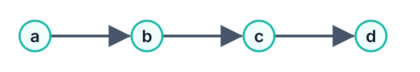
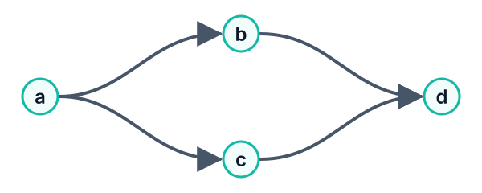
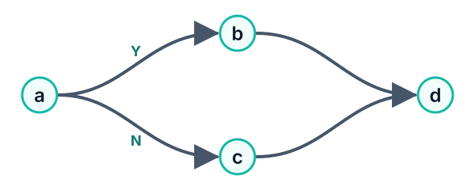
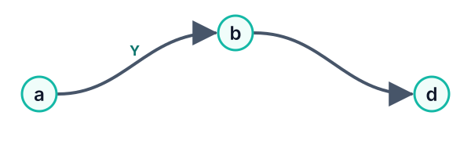
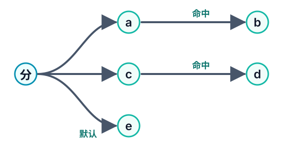
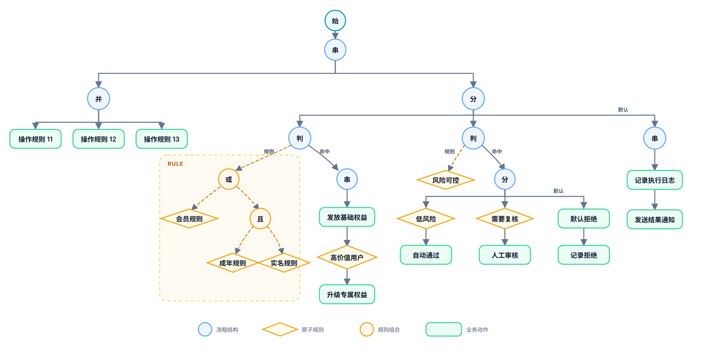
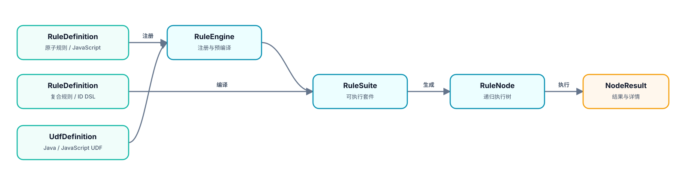

# Mosika

<p align="center">
  <strong>把业务规则画出来，就能编译、执行、追踪、回放</strong><br>
  <sub>模型驱动的可视化规则流语言与执行内核 · JDK 21 · Rhino · ANTLR4</sub>
</p>

<p align="center">
  <a href="#核心特性">核心特性</a> ·
  <a href="#规则流长什么样">规则流</a> ·
  <a href="#内置-udf-与-sys-能力库">内置能力</a> ·
  <a href="#快速开始">快速开始</a> ·
  <a href="./docs/规则模型核心设计.md">内核设计</a> ·
  <a href="./docs/规则编排交互设计.md">编排交互</a> ·
  <a href="./docs/运维与开发.md">运维开发</a>
</p>

---

Mosika 用一棵**可序列化、可递归遍历的 UI 树**表达业务规则的编排，并把它单向编译成内核执行树。这棵树同时是编辑模型、持久化格式、编译输入、执行结构和追踪载体——**从画布到运行时，始终只有一套语义**。

## 核心特性

- 🌳 **图即源代码** —— UI AST（其 JSON）是编辑与持久化的唯一事实来源，所见即所跑；执行、追踪、回放都在同一棵树上，绝不从执行树反推模型。
- 🔁 **一种递归模型，统一串行 / 并行 / 分支 / 循环** —— 串、并、分、循都是可互相嵌套替换的结构节点。因为是递归树而不是自由连线的 DAG，**没有流程交汇点、没有循环体边界**这些图的历史包袱，概念自始至终一致。
- 🧩 **规则定义与编排解耦** —— 原子规则封装稳定的业务事实（`ruleId`），规则流只引用它来表达策略。技术团队沉淀规则，产品与业务自由组合，两条生命周期独立演进。
- ♻️ **一条规则，多组参数** —— 原子规则可声明 `$args` 模板参数，同一个 `ruleId` 在一棵树里按节点绑定不同 JSON，不必为阈值差异复制出一堆几乎相同的规则。
- ⚡ **JS + Java UDF，内置 `sys.*` 强能力** —— 规则表达式可直接调用 JavaScript 与 Java UDF。内置库补齐了 JavaScript 做不到或不可靠的能力：精确金额（`BigDecimal`）、可靠日期（`java.time`）、加密哈希、Unicode 归一化。
- 🔍 **全链路可解释 + 在线试运行** —— `matched`（控制）与 `result`（业务）职责分离，配合递归执行详情树和动态描述；编辑器可对规则树一键试运行，并在画布上**高亮实际走过的执行路径**。
- 🪶 **进程内内核，零重依赖** —— `mosika-core` 是纯 JDK 21 进程内代码，用 Rhino 执行 JavaScript；`mosika-web` 提供开箱即用的 Spring Boot 参考控制面，但接入内核并不需要它。

## 规则流长什么样

DSL 的原子项是规则 ID，用运算符递归组合成任意结构：

<table>
  <tr>
    <td width="50%" align="center">
      <strong>串行</strong><br>
      <code>a-&gt;b-&gt;c-&gt;d</code><br><br>
      
    </td>
    <td width="50%" align="center">
      <strong>并行</strong><br>
      <code>a-&gt;(b=&gt;c)-&gt;d</code><br><br>
      
    </td>
  </tr>
  <tr>
    <td width="50%" align="center">
      <strong>完整条件</strong><br>
      <code>(a?b:c)-&gt;d</code><br><br>
      
    </td>
    <td width="50%" align="center">
      <strong>半条件</strong><br>
      <code>a?(b-&gt;d)</code><br><br>
      
    </td>
  </tr>
  <tr>
    <td colspan="2" align="center">
      <strong>有序多分支</strong><br>
      <code>a?b:(c?d:e)</code><br><br>
      
    </td>
  </tr>
</table>

<table>
  <tr>
    <td width="50%" align="center">
      <strong>有界循环</strong><br>
      <code>loop(3, shouldRetry, rebuild-&gt;check)</code><br><br>
      <sub>条件命中就执行循环体，最多 3 轮；循环体是普通子树，可任意嵌套</sub>
    </td>
    <td width="50%" align="center">
      <strong>带参数规则</strong><br>
      <code>threshold("""{"limit":100}""")</code><br><br>
      <sub>同一规则按节点绑定不同 JSON 参数，不必为阈值差异复制规则</sub>
    </td>
  </tr>
</table>

| 运算符 | 含义 |
| --- | --- |
| `a->b` / `a=>b` | 串行 / 并行 |
| `a?b:c` / `a?b` | 条件（完整 / 半条件） |
| `a&&b` / `a\|\|b` | 有序短路的与 / 或 |
| `all(...)` / `any(...)` / `some(min,max,...)` | 全部 / 任一 / 命中数量约束 |
| `loop(max,condition,action)` | 有界循环 |

结构是**显式声明**的，不从坐标、连线方向或隐式汇合推断。有界循环每轮先判断条件、命中后执行动作，条件与动作共享同一轮求值缓存，下一轮重算——循环也能自然嵌套：

```text
loop(3, shouldRetry, rebuildContent->qualityCheck)
```

## 规则定义与编排解耦

Mosika 从一开始就把**规则的生成**与**规则的编排**当作两个独立生命周期：

```text
规则生产：领域知识 ──> RuleDefinition(ruleId, expression, desc)
                              │  稳定 ruleId 引用
                              ▼
产品编排：业务策略 ──> 命名规则流(串行 / 并行 / 分支 / 循环)
```

规则生产侧把领域知识封装成有稳定业务语义、可独立测试与复用的最小单元；产品与业务侧只基于稳定 `ruleId` 组织规则流，不感知底层表达式或实现。规则实现可以独立演进，同一业务语义可被多个产品复用。

## 模板参数化规则

只有阈值不同的判断，过去要复制成多条规则；现在只定义一条模板，按节点绑定参数：

```text
threshold = $.input > $args.limit

threshold("""{"limit":100}""") || threshold("""{"limit":300}""")
```

执行环境始终暴露三个稳定入口：`$`（业务输入）、`$$`（共享可变上下文）、`$args`（当前节点绑定的模板参数）。相同参数组合在一次顶层执行内只求值一次，不同参数分别求值且各自保留执行详情。完整语义见[规则模型核心设计](./docs/规则模型核心设计.md#7-模板参数化)。

## 内置 UDF 与 `sys.*` 能力库

规则表达式可直接调用 JavaScript 与 Java UDF。`mosika-udf` 提供一组内置 Java UDF，全部挂在保留分组 `sys` 下，锚定 JavaScript 做不到或不可靠的能力：

| 分组 | 能力 | 示例 |
| --- | --- | --- |
| `sys.num` | `BigDecimal` 精确运算 | `sys.num.divide(a, b, 2)` |
| `sys.date` | `java.time` 日期 | `sys.date.daysBetween(a, b)` |
| `sys.crypto` | 哈希 / HMAC / Base64 | `sys.crypto.sha256(s)` |
| `sys.text` | Java 正则 / Unicode | `sys.text.normalize(s)` |
| `sys.coll` | 集合运算 | `sys.coll.sum(list)` |
| `sys.id` | 标识 / 随机 | `sys.id.uuid()` |

自定义 JavaScript UDF 可在控制面 `/udfs` 注册，例如把 `function bindCitations(target){...}` 注册为 `content.generation.bindCitations`，随后在规则里直接 `content.generation.bindCitations($)`。UDF 是进程内可执行代码，不是面向不受信任用户的配置；对外或多租户部署须在平台层补齐鉴权、审核与审计。

## 完整 UI 树

<p align="center">
  
</p>

<p align="center"><sub>Flow 是主递归域，Rule 通过判断节点单向嵌入；规则子树与命中流程边界清晰。</sub></p>

## 从定义到执行

<p align="center">
  
</p>

`RuleEngine` 注册全部规则、预编译原子 JavaScript，是规则注册的唯一事实来源；`RuleSuite` 装配规则与 UDF；UI 树经 `UINodeAdapter` 单向编译为 `RuleNode`，产品编排在边界处落为命名复合规则。定义先经过规模校验、结构校验和完整编译，参考 Web 在事务提交后才替换运行中的 `RuleSuite`，不向执行暴露半成品。

## 模块边界

| 模块 | 职责 | 不负责 |
| --- | --- | --- |
| `mosika-core` | DSL、规则树、执行上下文、求值、UDF 抽象与引擎、命名原子/复合规则 | 页面、持久化、Flow 产品模型与业务场景映射 |
| `mosika-udf` | 内置 Java UDF 实现（`sys.*`） | DSL/引擎内核、页面、Spring 装配 |
| `mosika-spring-boot-starter` | 扫描并注册 `@Udf` Bean，提供 `SpringUdfLoader` | 规则来源、`RuleSuite` 生命周期、数据库 UDF 管理 |
| `mosika-ui` | 可序列化 UI AST，单向编译为 `RuleNode` | 页面布局、Web 依赖、从执行树反推 UI |
| `mosika-web` | 可选的 UI/控制面参考实现：REST、SQLite、规则管理与可视化编辑 | 规则语义、执行内核、替代 Core/UI 库制品 |

## 快速开始

要求 JDK 21。

```bash
mvn clean test                 # 构建并运行全部测试
./scripts/mosika.sh start      # 构建并启动参考控制面
```

启动后访问：

- 产品首页：<http://127.0.0.1:8080/>
- 业务场景：<http://127.0.0.1:8080/scenes>
- 原子规则库：<http://127.0.0.1:8080/rules>
- UDF 注册中心：<http://127.0.0.1:8080/udfs>
- 规则流画布：`http://127.0.0.1:8080/flow/{id}`

其余命令（`dev` / `status` / `logs` / `restart` / `stop`）、环境变量与运行目录见[运维与开发](./docs/运维与开发.md)。

仓库还提供一套可重复导入的[内容生成领域演示数据](./mosika-web/src/main/resources/demo/README.md)：用 3 个领域 UDF、64 条原子规则和 7 条相互复用的规则流，模拟证据链、内容路由、多渠道适配和分级发布门禁，展示内核如何承载真实领域编排。

## 进一步阅读

- [规则模型核心设计](./docs/规则模型核心设计.md)：设计理念、DSL 语法、节点体系、引擎装配、求值缓存、UDF 内核能力与内置库、模板参数。
- [规则编排交互设计](./docs/规则编排交互设计.md)：规则定义与编排解耦、递归树统一串/并/分支/循环、UI 单向编译为 DSL、在线测试与执行路径渲染、版本生命周期。
- [运维与开发](./docs/运维与开发.md)：工程结构、构建测试、服务脚本、部署与 Java/JavaScript UDF 的定义、装配和使用。
- [更新日志](./CHANGELOG.md)
